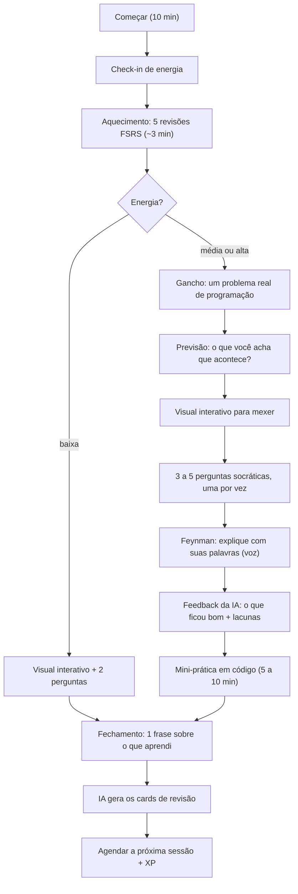

# Plano: app de estudo pessoal (anti-procrastinação, pensado para TDAH)

> Nome provisório: **Foco**. Para uso pessoal.
> Objetivo: conseguir sentar e estudar 15–30 min por dia, entender a **intuição** da matemática e **aplicar em programação**, com um projeto prático em cada tema.

---

## Resumo em 1 minuto

1. **Não comece do zero.** Já existe um projeto open source que faz uns 70% do que você quer: o [DeepTutor](https://github.com/HKUDS/DeepTutor) (Apache-2.0, ~40 mil estrelas, atualizado em setembro de 2026). Você sobe os livros e ele explica citando o livro, gera visualizações (inclusive animações em Manim), faz perguntas, gera quizzes e agenda revisões.
2. **Hoje mesmo:** instale o DeepTutor e estude 1 tópico, sem escrever nenhuma linha de código.
3. **Em no máximo 2 fins de semana:** construa o **Foco**, um app pequeno só com o que falta: a *camada TDAH* (um botão para começar, sessão curta com timer, nenhuma decisão para tomar), revisão espaçada com FSRS, registro de todas as suas respostas e um projeto prático por tópico.
4. **Regra de ouro:** construir o app não pode virar a desculpa para não estudar ("procrastinação produtiva"). **Toda sessão de programar o app começa com 15 min de estudo.**

---

## 1. Por que essa estratégia

Para quem tem dificuldade de começar, o maior risco deste projeto é passar semanas construindo o app perfeito e continuar sem estudar. Por isso você **estuda desde o primeiro dia** com algo pronto e constrói só o que realmente fizer falta.

| Você quer | O DeepTutor já tem? (segundo o README) | Onde entra no plano |
|---|---|---|
| Alimentar com os livros | ✅ Base de conhecimento com PDFs, leitura com citações | Fase 0 |
| Recursos visuais | ✅ "Visualize" (HTML interativo, Chart.js/SVG) e "Math Animator" (Manim) | Fase 0 |
| Perguntas socráticas | ✅ O tutor pausa para você responder + dá para instalar uma *skill* com o prompt da seção 8 | Fase 0 |
| Gravar suas respostas e acompanhar a evolução | ⚠️ Tem memória e progresso, mas não um painel focado na *sua* evolução | Foco |
| Repetição espaçada | ⚠️ "Practice" com revisão agendada, mas sem controle fino | Foco (FSRS) |
| Projeto prático por tópico | ⚠️ Dá para pedir, mas não vem estruturado | Foco + modelo da seção 6 |
| Ajuda para começar e manter o foco (TDAH) | ❌ | **Foco (o diferencial)** |

---

## 2. Repositórios e bibliotecas para copiar

| Projeto | Para que serve aqui |
|---|---|
| [HKUDS/DeepTutor](https://github.com/HKUDS/DeepTutor) (Apache-2.0) | Usar pronto na Fase 0; referência de como fazer o tutor, as visualizações e a leitura de livros |
| [zijinz456/OpenTutor](https://github.com/zijinz456/OpenTutor) (MIT) | Stack parecido (Next.js + FastAPI), já tem FSRS, flashcards e modo socrático. Ainda está em beta, então use para copiar ideias e trechos de código, não como base |
| [soumics/adaptive-ai-tutor](https://github.com/soumics/adaptive-ai-tutor) | Projeto pequeno e fácil de ler, com modo socrático, diagnóstico e revisão SM-2. Bom para entender o fluxo |
| [open-spaced-repetition/ts-fsrs](https://github.com/open-spaced-repetition/ts-fsrs) | O algoritmo de revisão espaçada **FSRS**, o mesmo que o Anki adotou. Pronto para usar em TypeScript |
| [awesome-fsrs](https://github.com/open-spaced-repetition/awesome-fsrs) | Lista de implementações e artigos sobre FSRS |
| [Mafs](https://mafs.dev) | Gráficos matemáticos interativos em React (arrastar vetores, mudar funções) |
| [KaTeX](https://katex.org) / [Mermaid](https://mermaid.js.org) | Fórmulas / diagramas |
| [Pyodide](https://pyodide.org) | Roda Python + NumPy no navegador (para os exercícios práticos) |
| [shadcn/ui](https://ui.shadcn.com) + Tailwind | Interface pronta e bonita sem esforço |

> As licenças Apache-2.0 e MIT permitem copiar código, desde que você mantenha o aviso de licença.

---

## 3. Técnicas de estudo → funcionalidades

Estas são as técnicas com mais evidência científica para **aprender de verdade** (e não só "sentir que aprendeu"):

| Técnica | O que é | Como vira funcionalidade |
|---|---|---|
| **Prática de recuperação** | Tentar lembrar sem olhar é melhor do que reler | Toda sessão começa com perguntas; você responde **antes** de ver a explicação |
| **Repetição espaçada** | Revisar pouco antes de esquecer | O FSRS agenda cada card; revisões diárias com um limite máximo |
| **Perguntas socráticas** | "Por quê?", "E se…?", "Como você sabe?" | Tutor que não entrega a resposta e faz uma pergunta por vez |
| **Técnica Feynman** | Explicar com as suas palavras | "Explique como se fosse para um amigo", por voz; a IA aponta as lacunas |
| **Codificação dupla** | Palavra + imagem | Todo conceito tem um visual interativo |
| **Geração / previsão** | Tentar antes de ver a resposta | "O que você acha que acontece se…?" antes de mostrar o visual |
| **Exemplos resolvidos que vão sumindo** | Ver resolvido, depois completar partes, depois fazer sozinho | Exercícios em 3 níveis: completo → com lacunas → do zero |
| **Intercalação** | Misturar temas na revisão | As revisões misturam matérias e tópicos |
| **Metacognição (calibração)** | Saber o que você sabe | Antes de responder: "Qual sua confiança, de 1 a 4?". O painel compara confiança com acerto |
| **Aprendizagem por projeto** | Aplicar no mundo real | Cada tópico termina com um mini-projeto em código |

---

## 4. Camada TDAH: as regras de design

A premissa: o problema não é falta de vontade. São três coisas, e o app ataca cada uma:

- **custo de começar** (muitas decisões antes de estudar);
- **cegueira temporal** (não sentir o tempo passar);
- **recompensa atrasada** (o benefício de estudar só aparece semanas depois).

1. **Um botão só.** A tela inicial é **"▶ Começar (10 min)"**. O app decide o que estudar. Você não escolhe nada antes de começar.
2. **Compromisso minúsculo.** "São só 10 minutos." Quando o timer acaba: *"Parar (ótimo!) ou mais 10?"*. Parar conta como vitória, não como fracasso.
3. **Check-in de energia (5 segundos).** Energia baixa → só revisão + um visual. Média → revisão + tópico novo. Alta → tópico novo + projeto.
4. **Timer sempre visível** (uma barra que vai esvaziando), contra a cegueira temporal.
5. **Recompensa imediata.** XP por resposta, barra de progresso do tópico e um mapa de tópicos que "acendem", com som e animação curtos.
6. **Sequência (streak) que perdoa.** Duas folgas por semana não quebram a sequência. Nada de tudo ou nada.
7. **Revisões com teto.** No máximo 20 cards por dia. Se acumular, o app redistribui. Nada de montanha de atrasados, que é o principal motivo de as pessoas largarem o Anki.
8. **Novidade constante.** O formato alterna entre visual, código, desafio e o "chefão" do tópico.
9. **Retomar de onde parou.** Fechar o app no meio não perde nada. Ao abrir de novo: "Continuar de onde parei".
10. **Estacionamento de pensamentos.** Um botão "💭 anotar distração": você escreve o pensamento e volta, sem sair da sessão.
11. **Estudar acompanhado (body doubling).** No modo "estudar junto", a IA faz um check-in a cada 5 min ("Em que parte você está?"). Também vale usar o Focusmate ou estudar em chamada com um amigo.
12. **Intenção de implementação.** Ao fechar a sessão, o app pergunta "Amanhã, que horas e onde?" e transforma a resposta em lembrete ("Amanhã, 19h, mesa do quarto").
13. **Interface sem culpa.** Sem vermelho, sem "atrasado", sem contador de dias perdidos.

---

## 5. Como funciona uma sessão (20–25 min)



Todas as suas respostas (texto ou voz transcrita), a confiança que você declarou e o feedback da IA ficam salvos. É com isso que o app mede a sua evolução.

---

## 6. Formato de cada tópico: da intuição à aplicação

Para cada tópico, a IA gera uma lição sempre com a mesma estrutura:

1. **Gancho:** um problema real de programação que precisa desse conceito.
2. **Intuição:** explicação sem fórmula, com analogia.
3. **Visual interativo:** algo para mexer (arrastar um vetor, mudar um parâmetro).
4. **Formalização:** só agora vem a fórmula, com cada símbolo ligado à intuição.
5. **Perguntas socráticas** (3 a 5).
6. **Onde aparece em programação:** 3 áreas (jogos, IA, dados, web…).
7. **Mini-prática:** exercício de código de 10 min (Python/NumPy no navegador).
8. **Projeto do mundo real:** de 1 a 3 h, opcional, para o fim de semana.
9. **Cards de revisão:** de 3 a 6 perguntas curtas.

Exemplos de como isso fica:

| Conceito | Intuição | Onde aparece | Mini-projeto |
|---|---|---|---|
| Vetores e produto escalar | "Quanto duas setas apontam para o mesmo lado" | Busca semântica, recomendação, embeddings de IA | Recomendador de filmes com similaridade de cosseno |
| Matrizes | "Máquinas que esticam e giram o espaço" | Gráficos 2D/3D, jogos, redes neurais | Girar e escalar um desenho no canvas com uma matriz |
| Derivada e gradiente | "Para onde a ladeira desce mais rápido" | Treinar modelos de IA (gradiente descendente) | Regressão linear do zero com gradiente descendente |
| Probabilidade e Bayes | "Atualizar a crença quando chega evidência" | Filtro de spam, testes A/B | Filtro de spam Naive Bayes |
| Logaritmo | "Quantas vezes dá para dividir ao meio" | Complexidade O(log n), busca binária | Medir busca linear vs. binária em 1 milhão de itens |
| Grafos | "Coisas + conexões" | GPS, redes sociais, dependências de pacotes | Menor caminho entre estações de metrô (Dijkstra) |
| Aritmética modular | "Um relógio que dá a volta" | Tabelas hash, criptografia, dígitos verificadores | Validador de CPF (módulo 11) e um RSA de brinquedo |
| Média e variância | "Centro e espalhamento" | Monitoramento, detecção de anomalias | Detector de anomalias em logs |

---

## 7. Arquitetura do Foco (MVP)

### Stack

| Parte | Escolha | Por quê |
|---|---|---|
| App | **Next.js** (App Router) + **TypeScript** | Front e back num projeto só, fácil de publicar; as IAs de código conhecem muito bem |
| Interface | Tailwind + shadcn/ui | Componentes prontos |
| Banco | **SQLite** com Drizzle ORM → **Turso** quando quiser usar no celular | Zero configuração no começo; o Turso é SQLite na nuvem, com o mesmo código |
| IA | **Claude** via SDK oficial `@anthropic-ai/sdk` | Lê PDF direto, cita a página do livro, cache barato |
| Revisão espaçada | **ts-fsrs** | FSRS pronto |
| Visuais | HTML gerado pela IA num iframe isolado (`sandbox="allow-scripts"`), mais Mafs, KaTeX e Mermaid | A IA consegue criar qualquer visual, sem risco para o app |
| Código | **Pyodide** | Roda Python + NumPy no navegador, sem instalar nada |
| Voz | Web Speech API (Chrome) | Responder falando dá menos preguiça do que digitar |
| Celular | PWA (instalar na tela inicial) + notificações | Lembrete na hora combinada |

### Telas (5)

1. **Hoje:** botão *Começar*, sequência de dias e o resumo "5 revisões + 1 tópico (~20 min)".
2. **Sessão:** o fluxo da seção 5, com timer.
3. **Revisão:** cards do FSRS. Você responde (texto ou voz), a IA corrige e a correção vira a nota do card.
4. **Biblioteca:** matérias → livros (PDF) → tópicos (capítulos ou seções).
5. **Progresso:** dias estudados, retenção, calibração, tópicos dominados e projetos.

### Modelo de dados

```text
subjects     (id, name, color)
books        (id, subject_id, title, anthropic_file_id)
topics       (id, book_id, title, pages, position, status: novo|estudando|dominado)
lessons      (id, topic_id, content_json, created_at)          -- lição gerada 1 vez e salva
cards        (id, topic_id, question, expected_answer,
              due, stability, difficulty, reps, lapses, state, last_review)  -- campos do ts-fsrs
answers      (id, topic_id, card_id NULL, question, my_answer, confidence,
              ai_feedback, rating, created_at)                  -- TODAS as suas respostas
sessions     (id, started_at, ended_at, planned_min, energy, summary)
projects     (id, topic_id, brief, status, repo_url)
distractions (id, session_id, text, created_at)
```

### Revisão espaçada (ts-fsrs)

```ts
import { createEmptyCard, fsrs, generatorParameters, Rating } from 'ts-fsrs'

const scheduler = fsrs(generatorParameters({ request_retention: 0.9 }))

// card novo, criado ao fim da sessão
const card = createEmptyCard()

// depois que a IA corrige sua resposta (prompt 3 → "good")
const { card: next, log } = scheduler.next(card, new Date(), Rating.Good)
// salva `next` (com o novo `due`) na tabela cards e `log` no histórico
```

### As 4 chamadas de IA

| # | Chamada | Entrada | Saída |
|---|---|---|---|
| 1 | **Gerar lição** (1 vez por tópico) | PDF do capítulo (enviado 1 vez pela Files API) + modelo da seção 6 | JSON validado (*structured outputs*), salvo em `lessons` |
| 2 | **Tutor socrático** (chat com streaming) | Lição salva + trecho do capítulo | Uma pergunta por vez, **citando a página do livro** (*citations*) |
| 3 | **Corrigir resposta → nota FSRS** | Pergunta, resposta esperada, sua resposta, sua confiança | `again` / `hard` / `good` / `easy` + feedback + lacuna |
| 4 | **Gerar cards** (fim da sessão) | Suas respostas e as lacunas da sessão | 3 a 6 cards novos |

Detalhes práticos:

- Mande **um capítulo por vez**, não o livro inteiro. O limite é de 600 páginas / 32 MB por requisição, mas capítulo é mais barato e mais focado.
- A lição é gerada **uma vez** e salva. O chat usa a lição salva (pequena), não o capítulo inteiro, e isso barateia muito cada sessão.
- As citações não funcionam junto com o JSON estruturado. Por isso a chamada 1 usa JSON e a chamada 2 usa citações.
- A chave da API vai em `.env.local`. **Nunca faça commit dela.**

### Custo estimado

Modelo padrão: `claude-opus-5-5` (US$ 4 por 1 milhão de tokens de entrada, US$ 20 por 1 milhão de saída e US$ 0,20 por 1 milhão em leitura de cache).

- Gerar a lição de um capítulo de ~30 páginas: ~US$ 0,30 a 0,60, **uma vez por tópico**.
- Uma sessão de tutor usando a lição salva: centavos.
- **Ordem de grandeza: US$ 10 a 20 por mês estudando quase todo dia.** Se quiser gastar menos, dá para usar `claude-sonnet-5-5` (metade do preço) no tutor e na correção. Essa troca é decisão sua.

---

## 8. Prompts principais (o "cérebro" do app)

Use o prompt 1 já na Fase 0, como instrução ou *skill* no DeepTutor.

### Prompt 1: tutor socrático

```text
Você é meu tutor socrático de matemática aplicada à programação.
Provavelmente tenho TDAH: seja breve, dinâmico e encorajador.

Regras:
- Faça UMA pergunta por vez e espere minha resposta.
- Não entregue a resposta. Se eu travar, dê uma dica menor. Se eu travar de novo,
  mostre um exemplo resolvido PARECIDO (não o mesmo) e me devolva a pergunta.
- Intuição e imagens mentais primeiro; fórmula só depois.
- Sempre conecte o conceito a um uso real em programação.
- Mensagens curtas: no máximo 4 frases + a pergunta.
- Quando eu acertar, diga em 1 frase exatamente o que ficou bom e suba um nível.
- Quando eu errar, não diga "errado": faça uma pergunta que me faça ver a contradição.
- Cite a página do livro quando usar o material.
- A cada ~5 minutos, faça um check-in: "Ainda aqui? Em 1 frase, o que entendemos até agora?"
- No fim, peça que eu explique tudo com as minhas palavras (Feynman) e aponte as lacunas.
```

### Prompt 2: gerar lição (saída em JSON)

```text
A partir do capítulo em anexo, gere a lição do tópico "{topico}" no formato abaixo.
Público: estudante de programação que quer a INTUIÇÃO da matemática e aplicá-la.
O visual deve ser um HTML completo e autocontido (pode usar p5.js, Plotly ou D3 via CDN),
interativo (algo para arrastar ou ajustar) e com fundo claro e escuro legíveis.
A mini-prática é em Python (roda no Pyodide, NumPy disponível) e inclui testes.
```

```json
{
  "gancho": "problema real de programação que precisa deste conceito",
  "intuicao": "explicação sem fórmula, com analogia",
  "visual": { "descricao": "o que mexer e o que observar", "html": "<!doctype html>..." },
  "formalizacao": "fórmula em LaTeX, com cada símbolo ligado à intuição",
  "perguntas_socraticas": ["...", "...", "..."],
  "aplicacoes": [{ "area": "IA", "exemplo": "..." }],
  "mini_pratica": { "enunciado": "...", "codigo_inicial": "...", "testes": "..." },
  "projeto": { "titulo": "...", "descricao": "...", "passos": ["..."] },
  "cards": [{ "pergunta": "...", "resposta": "..." }]
}
```

### Prompt 3: corretor → nota do FSRS

```text
Compare minha resposta com a esperada. Avalie o ENTENDIMENTO, não as palavras exatas.
Critérios:
- again = não lembrou ou confundiu o conceito
- hard  = lembrou, mas com erro importante ou incompleto
- good  = correto
- easy  = correto, completo e com exemplo próprio
Minha confiança declarada foi {confianca}/4. Se eu estava confiante e errei, destaque isso.
Responda em JSON: {"nota": "...", "o_que_acertei": "...", "lacuna": "...", "pergunta_de_seguimento": "..."}
```

---

## 9. Roteiro

### Fase 0: hoje (1 a 2 h). Estudar, não programar

- [ ] Escolher **1 matéria** e **1 capítulo** desta semana.
- [ ] Instalar o DeepTutor: `pip install -U deeptutor`, depois `deeptutor init` e `deeptutor start` (ou pelo Docker, ver o README).
- [ ] Configurar a chave de API (ele aceita Anthropic, OpenAI, Gemini, Ollama e outros).
- [ ] Subir o PDF do livro.
- [ ] Usar o **prompt 1** e estudar 1 tópico por 20 min.
- [ ] Definir um horário fixo: "todo dia às __h, em __".
- [ ] Durante a primeira semana, anotar num papel o que te fez abrir (ou não abrir) e o que faltou.

### Fase 1: fim de semana 1. Foco MVP

- [ ] Criar o projeto: `create-next-app` + Tailwind + shadcn/ui + Drizzle/SQLite.
- [ ] Biblioteca: cadastrar matéria, livro e tópico; enviar o PDF para a Files API.
- [ ] Gerar a lição (prompt 2) e mostrar os blocos na tela.
- [ ] Telas **Hoje** e **Sessão**, com timer e check-in de energia.
- [ ] Chat socrático (prompt 1) com streaming, salvando cada resposta em `answers`.
- [ ] Cards + revisão com ts-fsrs + corretor (prompt 3).

**Pronto quando:** você consegue fazer uma sessão completa de 20 min só pelo Foco.

### Fase 2: fim de semana 2. O acabamento

- [ ] Visual interativo no iframe isolado.
- [ ] Mini-prática com Pyodide (rodar e testar o código).
- [ ] Responder por voz.
- [ ] Tela de progresso: dias estudados, retenção, calibração, tópicos.
- [ ] XP, sequência com folgas, estacionamento de distrações.
- [ ] PWA + lembrete no horário combinado; migrar para Turso e publicar (Vercel) para usar no celular.

### Fase 3: depois (só se você estiver usando de verdade)

- Relatório semanal gerado pela IA ("você domina X, está fraco em Y; próxima semana: Z").
- Modo prova: questões no estilo das provas antigas do seu professor.
- Mapa de pré-requisitos entre os conceitos.
- Vídeos em Manim usando o DeepTutor.

### Decisão no fim da semana 1

- **Estudou 4 dias ou mais com o DeepTutor?** Ótimo. Construa só a camada TDAH e a revisão.
- **Não conseguiu estudar?** O problema é começar. Faça primeiro a tela Hoje, o timer e o lembrete, antes de qualquer outra coisa.
- **Passou mais tempo programando o app do que estudando?** Pare o app por 1 semana e só estude.

---

## 10. Como saber se está funcionando

| Métrica | Meta inicial |
|---|---|
| Dias com sessão por semana | 4 ou mais |
| Retenção nas revisões (good/easy) | ~85–90% |
| Calibração (confiança × acerto) | Melhorando com o tempo |
| Mini-práticas feitas | Pelo menos 1 por semana |
| Projetos do mundo real | 1 por mês |

---

## 11. Perguntas em aberto

- **Qual é o "Jev"?** Não reconheci pelo nome. Me passe o link do GitHub ou o site e eu comparo com este plano (pode ser que ele já sirva de base).
- Quais **matérias e livros** deste período?
- Você vai estudar mais no **computador** ou no **celular**?
- Qual **linguagem** prefere para as práticas? (Sugestão: Python.)

> **Sobre o TDAH:** se você suspeita, vale fazer uma avaliação com psiquiatra ou neuropsicólogo. Muitas faculdades têm núcleo de acessibilidade ou apoio psicopedagógico gratuito. O app ajuda, mas não substitui isso.

---

### Fontes

- [HKUDS/DeepTutor](https://github.com/HKUDS/DeepTutor)
- [zijinz456/OpenTutor](https://github.com/zijinz456/OpenTutor)
- [soumics/adaptive-ai-tutor](https://github.com/soumics/adaptive-ai-tutor)
- [open-spaced-repetition/ts-fsrs](https://github.com/open-spaced-repetition/ts-fsrs)
- [open-spaced-repetition/awesome-fsrs](https://github.com/open-spaced-repetition/awesome-fsrs)
- [Tópico "ai-tutor" no GitHub](https://github.com/topics/ai-tutor)
